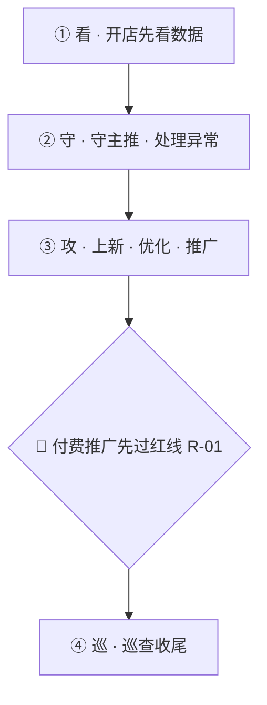

# 运营组规则

> 适用：运营专员 嘉欣（于嘉欣）/ 荔枝（何小琴）/ 娜娜（王娜）/ 鹤子（徐鹤）/ 洪洪（洪丽华）/ 老孙（孙庆弘）/ 同同（张桐）
> **本地状态**：⭐ 最终版（权威源）
> **团队可见版**：团队知识库 team-kb（GitHub `xiangxin-team-kb`，运营用 Obsidian 查看），以团队库为准。
> ⚠️ 原飞书 wiki [运营工作流程框架](https://xiangxingolf.feishu.cn/wiki/APIhwieqOin5UJkboMWcrm9ZnGg)（token `APIhwieqOin5UJkboMWcrm9ZnGg`）已于 **2026-06-10 停用**、不再更新，仅作历史留存。
> **最近同步**：2026-06-18（新增「运营每日工作流程总览（看·守·攻·巡）」，把 9 条关键动作 + 每日清单 + 上架流程重排成一天的动作顺序，来源祥书手绘流程图）；2026-05-26（新增「每日必做检查清单」4 条 +「上架与选品标准流程」）

> 📌 本地是最终版。每周一自动跑同步任务对齐飞书内容。日常具体问题去【问题日志 Base】(`CWuIblgzqaW7lUsivCBccKSmnqf`) 走七步流程。
> 📌 与其它部门规则的关系：本文「客服监督」一节是从**运营视角**监督客服，跟 [[06-销售客服规则]]（给客服团队看的执行规则）配套，不冲突。「供应链与发货」一节跟 [[04-采购规则]] 有重叠，以采购规则中具体 SOP 为准。

---

# 红线规则（不可违反）

> 写在最前，所有运营动作必须先过这一关。违反需向祥书书面说明原因。
> 红线持续追加，按 R-XX 编号；新增红线必发推送通知。

## R-01 付费推广前置条件（无基础不推广）

### 一、三必须（同时满足才可付费推广）

1. 30 天销量 ≥ 3 单
2. 真实评价 ≥ 1 条
3. 买家秀晒图 ≥ 3 张（图文或视频）

任一不满足 = 禁止直通车 / 引力魔方 / 万相台 / 淘宝客 / 京准通 / 京东快车 等**任何付费推广**

### 二、不达标怎么办（合规打基础方式）

- 老客户晒图返现（额度报祥书审）
- 可以补单（刷单）安排朋友做评价

---

## R-02 定制 / 延迟单不得"瞒着客户"发虚假单号

### 一、规则

1. **禁止**：在客户未知情的情况下，直接发虚假单号"占位"冒充已发货。
2. 识别到定制 / 缺货 / 延迟单时，**先做沟通**（二选一）：
   - 旺旺 / 千牛跟客户说清需要多等几天，征得同意。
   - 有客户微信的，私聊说明并征得同意。
3. 客户同意后，**两条合规走法**：
   - **方案 A**：等定制完成，再用真实单号发货。
   - **方案 B**：先发虚假单号占位（防平台超时扣分） → **同时告知客户**"先发占位单号，真实单号定制好后单独发您"。
4. 真实单号必须**主动**推送给客户，不等客户来追问。
5. 客户咨询订单时，客服**按实情答复**，禁止顺着虚假单号说"已发货请等签收"。

### 二、原因

虚假单号占位本身是行业通用做法，但**不告知客户 = 欺骗** → 客户没收到货会找快递公司投诉 → 麻烦回到我们 → 客诉 / 差评 / 平台介入。

已发生案例（2026-05-14）：客户买定制 VESSEL 7.5 寸支架球包，运营/库房直接发了韵达虚假单号到上海青浦代收点冒充"已签收"，客户没收到货找韵达投诉。

### 三、执行职责

1. **审单发货组（舒怡 / 阳阳 / 鹤子 / 九一）**：审单时识别定制/延迟单；发虚假单号前确认"是否已告知客户"再放行；定制完成后第一时间出真实单号。
2. **运营专员（嘉欣 / 荔枝 / 娜娜 / 鹤子 / 洪洪 / 老孙 / 同同）**：本店订单的客户沟通责任人，旺旺/微信跟客户说明并留痕。
3. **客服销售组（凌晨 / 月阳 / 珊珊 / 月月）**：客户咨询订单进度时按实情答复，发现虚假单号未告知 → 当场跟运营 + 阳阳报备。
4. **违反**：1 次客诉到平台 / 投诉到快递公司 → 报阿祥；情节严重扣绩效。

---

## R-03 品牌方重要通知必须转任务跟进

**适用**：所有品牌方发来的需要执行的通知（控价 / 调价 / 活动政策 / 下架 / 罚款警告 / 补贴申报等）
**生效**：2026-06-10
**执行人**：全体运营专员
**审批人**：祥书

### 一、规则

1. 品牌方发来重要通知，**不能只在群里发个知会就完事**——必须转成飞书任务（挂【祥新任务】清单）。
2. 任务三要素缺一不可：
   - **负责人**：落到具体人，不是 @所有人 就完事
   - **截止时间**：默认当天 20:00 / 次日 18:00
   - **交付物**：改价后截图 / 下架截图 / 检查结果回报，贴在任务评论区；没交付物视为未完成
3. 任务关闭前必须有人跟进核实，不是发出去就算处理完。

### 二、原因

品牌通知都是必须处理的事（控价罚款、强制下架、活动报名有截止日），群消息容易被刷过去没人认领，事后也查不到谁改了谁没改。任务有负责人 + 截止 + 交付物才能闭环。

### 三、来源

邹祥书 2026-06-10 提出，纠错日志 `recvjsMdjZtkwH`。

---

# 运营每日工作流程总览（看 · 守 · 攻 · 巡）

> 用途：把下面「9 条关键动作 + 每日必做清单 + 上架流程」按**一天的实际动作顺序**串成一条线——新人照着走、老人对着自查。每步只点到为止并标明出处，细则不在这里重复，往下翻对应章节即可。
> 来源：祥书 2026-06-18 手绘运营流程图 + 现有规则对齐。
> 一句心法：**先看清楚（看）→ 守住主推不出错（守）→ 主动上新优化拿增量（攻）→ 收尾巡查不留坑（巡）。**

## 四阶段对照表

| 阶段 | 这一步干什么 | 对应细则 |
|---|---|---|
| **① 看** | 开生意参谋看大盘（GMV / 订单 / 转化率）+ 后台「风险和异常商品」；竞品今天卖了啥，立刻去自己店搜「上没上、价高没高」 | 每日清单 ②④ |
| **② 守** | ①主推款三查：价格 / SKU / 主图（活动期每天 2 次）；②缺货款**别下架**，换同品牌新款→当季热款续上；③沉睡链接出单 / 销售拍单后的链接 → 当日比价 + 优化 | 关键动作 ④⑤⑧ · 每日清单 ① |
| **③ 攻** | ①上新：每周≥2 次、每月≥25 款，对标同行卖最好的店（SKU 不少于人）；②新款 → 新链接 + 老链接同步拼新款；③优化 SKU/图/价/详情 → 测主图 → 数据达标的转固定主图引流；④补单：每周≥3 次 | 关键动作 ①②③⑨ · 每日清单 ① |
| 🔴 **闸门** | **付费推广前必过红线 R-01**：30 天≥3 单 / 真实评价≥1 / 买家秀≥3 张，缺一**禁止**任何付费推广 | 红线 R-01 |
| **④ 巡** | ①手机巡店（一律手机看，能看到 88VIP / 专享券 / 糊图）：主推款比价 · 库存 · SKU · 详情；②整店巡查：满减/活动是否掉、违禁词、死链（掉满减自己加立减）；③店铺形象：好用的版式别动，只换色系 / 改活动标题 | 关键动作 ⑥ · 每日清单 ①②③ · 上架选品流程 |

---

# 日常运营关键动作 9 条

> 来源：祥书 2026-05-18 录音 + 同同实操经验；第 9 条 2026-05-26 新增。
> 适用：所有运营专员（嘉欣 / 荔枝 / 娜娜 / 鹤子 / 洪洪 / 老孙 / 同同）。
> 核心心法：**好链接是宝贝，要用起来，别浪费。**

## 1. 新款 / 限量款 → 新链接 + 老链接同步上新款

看到品牌方或同行出新款、限量款（例：泰勒梅大师赛球出来），两个动作**同时**做：

1. **新上一个链接**：详情 / SKU / 标题，参考同行卖得最好的对标店铺，对齐他们最齐全的版本（自查 SKU 数量不能比同行少）
2. **店里有同类老链接（在推类似产品）→ 把新款拼进老链接里**：主图 / 详情 / SKU / 标题都优化，**老链接优先展示新款**（例：泰勒梅大师赛球出来 → 拼到本店泰勒梅球有销量的老链接里）

思路：老链接已有权重，借势上新款；新链接同步开权重，两条腿走路。

## 2. 自己想推的款 → 也对标同行最好做法

- 选自己计划主推的款时，先看同行卖得最好的对标款
- 详情 / SKU / 标题，照搬同行最好做法，再做优化

## 3. 补单：每周至少 3 次

- 一周 5 个工作日，至少 3 天有补单动作

## 4. 沉睡链接突然出单 → 当日优化

- 好久没卖的链接今天出单了 → 当日内立马优化（详情 / 标题 / 价格 / SKU）
- 借这次出单的权重，让链接二次跑起来

## 5. 销售拍单后的链接 → 立刻比价 + 优化

- 销售给某个链接集中拍单后（例：SM 11 之前不好卖，销售一次拍 10 单，销量立马起来），链接就有权重了
- 立刻比价：本店价格高于同行 → 立马调价
- 同时优化标题，借势把链接转化做起来 类似于第4点

## 6. 店铺形象 → 换色不动板式

- AI 做不出好图 → 用现成好用的版式
- 别人之前做的好用摆图、活动版式 → 不要动
- 要迭代主图 / 活动图 → 换色系、改活动标题就行，摆位不要动

## 7. 生意参谋大榜 → 每天看

- 熟悉产品的运营，每天开生意参谋大榜
- 看同行卖的款：
  - 我们没上 → 立即上链接
  - 已上 → 看价格是否高于同行：高了立即调价 + 优化标题 + 检查 SKU 数是否比别人少

## 8. 卖得好的链接没货了 → 别下架，换品继续上

- 链接还在卖（哪怕销量不高，比如 30 日 4 单），但商品断货 → 别直接下架放仓库
- 替换优先级：
  1. 同品牌新款（例：卡拉威球缺货 → 用卡拉威其他新款）
  2. 同品牌没货 → 换品类热款（例：换大师赛球这种当季热款）
- 替换后同步更新主图 / 标题 / SKU / 价格

## 9. 上架节奏：每周至少 2 次、每月至少 25 款

> 生效：2026-05-26。适用：所有运营专员。作为运营工作的基本要求。

- 上架是**持续动作**，不是一次性凑量任务。
- **频次下限**：每周至少做 2 次上架动作（不少于 2 次）。
- **数量下限**：每月至少上 25 款商品。
- 目的：避免「为完成任务突击上架」（如一天上 20 多款），回到「及时上新 + 定期巡查」的初衷。

## 10. 产品排名记录

> 适用：所有运营专员。

- 每周记录 2 次（周一、周四左右各一次）
- 记录到「竞店监控表」
- 把产品排名同步到运营周报里

---

# 每日必做检查清单（运营每日底线）

> 背景：会上发现有运营长期漏做「主推品检查」，祥书强调这是大问题——自己主卖的几个产品要如数家珍，天天看才熟。

## 1. 主推产品检查（每天；活动期每天 2 次）

逐个打开本店主推 / 有销量的链接，**核心看三项：价格、SKU、主图**：

- **价格**：有没有错价、有没有比同行高
- **SKU**：规格 / 价格对不对，有没有可以补进链接的关联款
- **主图**：该上的主图 / 打标有没有上
- 附带看：满减 / 优惠有没有掉、过期活动有没有还挂着（掉满减自己加立减）

## 2. 风险 / 异常商品检查（每天）

- 后台「风险和异常商品」每天看一遍
- 掉满减的加立减，盯异常数量有没有增加

## 3. 库存检查（每天下班前 / 至少每周一次）

- 看已卖出宝贝还有没有库存，库存加得少的容易卖空
- 千牛后台 / 手机千牛会提示「库存卖空」→ 立即补库存
- 库存深的款可适当放宽频次

## 4. 看大盘 + 竞品对比优化（每天，看大盘时顺带做）

- 生意参谋看大盘，看同行 / 竞品今天卖了什么款
- 立即去自己店搜：这款我们上没上架？价格有没有比对方高？
- 高了立即改价、借势优化标题——竞品在实时改价，我们也要实时跟

---

# 系统知识：总仓库存查询可查所有卖过商品的成本

吉客云「总仓库存查询」里，**只要卖过的商品都能查到成本——当前没库存（库存为 0）的也能查**。调价、活动核价、报价需要成本时先自己查，不用先问采购/财务；从未卖过的全新商品再找采购确认。**同一商品有多个报价/成本时，对客报价尽量参考贵的那个**——低价可能是活动/套餐价，不保证随时有。成本仅内部使用，不对客户透露。完整规则见 [[06-销售客服规则]] 客服-012。

---

# 上架与选品标准流程

> 来源：妙记 2026-05-26。适用：自己盘竞品店上新的运营（荔枝 / 同同）；娜娜 / 洪洪见下方分工。

## 一、选品（定要上哪些款）

1. 维护一张**竞品店清单表**，把要盯的竞品店都写进去
2. 逐个点进竞品店看有没有新款，记录每个店「上次上到哪了」，下次接着往后看，不重不漏
3. 看到新款 → 复制链接 →（先放违禁词助手过一遍）→ 进上架流程
4. **巡店一律用手机看**：顾客都用手机，电脑看不到 88VIP、专享券等手机端专属优惠，详情图也是手机端才看得出糊不糊。后台操作才用电脑。

### 分工

- **荔枝 / 同同**：自己盘竞品店选品上新
- **娜娜 / 洪洪**：参考荔枝店 / 高尔夫自营总店，他们上什么就跟着上，不用自己盘总店

## 二、上架操作步骤

1. 选好目标店铺，登录淘宝卖家后台
2. 复制竞品链接，在采集软件里上传
3. 登录**个人淘宝买家号**采集（过验证码）
4. 软件解析图片 / 详情 → 改价 → 发布上架

## 三、卡点与应对（重点）

1. **采集只能用个人淘宝号，绝不能用千牛 / 卖家号采集**——卖家号采集极易被封
2. **账号被封应对**：每人多备几个个人淘宝号，一个被封换下一个
   - 一个手机号约可注册 6 个淘宝号（关联 5 个小号），实名认证上限 3-4 个；可用邮箱注册 + 绑手机 + 解绑的方式扩号
   - 封号多为临时（3 天 / 7 天 / 半个月），少有永久；被封与上架数量不一定强相关，采集插件（电透视等）也可能触发
3. **鞋服等多规格 SKU**：软件常抓不准（图片堆成一排），只能手动去后台改；鞋服上得少，影响不大
4. **验证码反复弹**是采集软件通病，过了才能上
5. **不必纠结「数据包 / 软件上架权重低」**：实测新品有销量，平台会给新品扶持

> 进行中（方案定了再同步，当前仍按上述流程走）：
> - **荔枝跟进**上架采集软件优化方案：问第三方付费插件 / 试用、对比换软件，解决封号 + 验证码卡点。
> - 祥书测试用 Claude 自动扫竞品店出「新款清单」+ 辅助上架。

---

# 运营工作流程框架

<quote-container>

用途：这是一版给团队共创的运营流程框架。先把模块和层级列清楚，后续大家直接在每个条目下面补充具体内容即可。
</quote-container>

## 填写说明

每个三级分类下，统一补充以下内容：

- 具体工作内容：
- 执行频次：
- 负责人：
- 使用工具/后台：
- 输出结果/目标：
- 检查标准/KPI：
- 备注：

## 现有知识库可先复用的文档

- [运营交接文档](https://xiangxingolf.feishu.cn/wiki/UmY8wXNXZiEx56k2Fvoc8ZL1neg)
- [运营助理岗位工作流程](https://xiangxingolf.feishu.cn/wiki/HVA7wE0n5izfnqkneX8cBoBUnad)
- [运营助理工作流程](https://xiangxingolf.feishu.cn/wiki/WsQEwkcg8i8mmck7fSiccr9pnRB)
- [岗位说明书：淘宝天猫运营助理](https://xiangxingolf.feishu.cn/wiki/PcmZw4VTLiAn6QkCvwXcLyflnRf)
- [私域运营流程](https://xiangxingolf.feishu.cn/wiki/Upmnw2FmMidh2KkbwkzcBdfgnyd)
- [微信引流方案](https://xiangxingolf.feishu.cn/wiki/VrhwwAHwhiyWB1khalgc16bWncn)
- [关于开展“淘宝成交倍增计划”及销售提成上调的通知](https://xiangxingolf.feishu.cn/wiki/UVNgwRCqzisYZFkwyuFcQqzzn2f)
- [淘宝销量翻倍](https://xiangxingolf.feishu.cn/wiki/XtFdwRQt8igG1vkpNdicp908nWh)
- [电商运营新人入职首日标准化交接 SOP](https://xiangxingolf.feishu.cn/wiki/X3V5wzuHmiIq83khFy6cCaGwnYd)
- [淘宝集运仓发货](https://xiangxingolf.feishu.cn/wiki/RrQ8w5N2oiM5zvkTmgzcJKtMnnh)
- [采购工作](https://xiangxingolf.feishu.cn/wiki/H3xVwgry9iXfjjkjRqIcz0dynjf)
- [定制供应商](https://xiangxingolf.feishu.cn/wiki/Ixg0wgYSmiCwJlkliGdcOFjhnYg)
- [周报模版](https://xiangxingolf.feishu.cn/wiki/BqgnwG6XWig2OmkK6dXc8Tn7nTf)
- [客服聊天成交优化培训](https://xiangxingolf.feishu.cn/wiki/MgRBwR3aniJJyHkwivLc2BPfnwc)

---

## 广告

### 1. 账户规划

#### 1.1 平台/店铺/站点划分

- 具体工作内容：
- 执行频次：
- 负责人：
- 使用工具/后台：
- 输出结果/目标：
- 检查标准/KPI：
- 备注：

#### 1.2 广告目标设定

- 具体工作内容：围绕 ROI、加购收藏、访客数、销售额、订单量、转化率等指标设定季度和月度目标，并明确主推品、次推品、全店计划的投入侧重。
- 执行频次：
- 负责人：
- 使用工具/后台：
- 输出结果/目标：
- 检查标准/KPI：
- 备注：可先参考《2025年运营OKR 计划总结参考》的目标拆法。

### 2. 投放搭建

#### 2.1 广告活动创建

- 具体工作内容：现有知识库里已经提到阿里妈妈推广矩阵，需按工具拆分直通车、引力魔方、万相台、淘宝客的在跑计划、预算、核心目标和当前状态。
- 执行频次：
- 负责人：
- 使用工具/后台：阿里妈妈、直通车、引力魔方、万相台无界版、淘宝客。
- 输出结果/目标：清楚掌握每个推广工具当前在跑什么、为什么跑、预算多少、是否要继续。
- 检查标准/KPI：
- 备注：可先参考《运营交接文档》里的“阿里妈妈推广矩阵”部分。

#### 2.2 关键词/定向策略

- 具体工作内容：整理核心关键词表、人群溢价设置、拉新 vs 收割的人群包逻辑、不同计划的测款/冲量目的。
- 执行频次：
- 负责人：
- 使用工具/后台：直通车、引力魔方、生意参谋。
- 输出结果/目标：明确每类词和定向策略背后的投放意图，不只是保留设置结果。
- 检查标准/KPI：
- 备注：可补充“哪些计划不能随便关”“哪些计划 ROI 低但承担测款作用”。

### 3. 素材管理

#### 3.1 主图/视频/文案素材

- 具体工作内容：现有知识库明确要求主图、视频、文案要符合高尔夫调性，检查图片清晰度、是否露出竞品 Logo、是否有活动氛围图和利益点透出。
- 执行频次：
- 负责人：
- 使用工具/后台：设计需求工单、主图视频素材库、详情页素材库。
- 输出结果/目标：素材能支撑投放、上架、活动、内容分发四个场景。
- 检查标准/KPI：
- 备注：可叠加《淘宝销量翻倍》里的“主图 CTR 决定生死、前 3 秒决定视频流量上限”的思路。
- 活动期间的这种图片自己设置任务，定期修改。。

### 4. 日常优化

#### 4.1 预算调整

- 具体工作内容：根据各推广工具实时消耗、ROI 门槛、场景目标调整预算分配，避免欠费停投或低效空烧。
- 执行频次：
- 负责人：
- 使用工具/后台：万相台、直通车、引力魔方。
- 输出结果/目标：预算向高产出计划倾斜，低效计划及时收缩。
- 检查标准/KPI：
- 备注：现有文档里提到“全店 ROI 门槛设为 2.5，低于此值系统会自动暂停”，可作为补充样例。

#### 4.2 出价调整

- 具体工作内容：根据点击率、转化率、计划目标和竞争强度微调出价，区分测款、收割、冲量计划。
- 执行频次：
- 负责人：
- 使用工具/后台：直通车、引力魔方。
- 输出结果/目标：
- 检查标准/KPI：
- 备注：建议后续把“什么情况下加价/降价/停投”写成固定判断规则。

#### 4.3 投放词/否定词管理

- 具体工作内容：维护投放词表现、筛掉无效词和低意向词，沉淀高转化词和否定词规则。
- 执行频次：
- 负责人：
- 使用工具/后台：
- 输出结果/目标：
- 检查标准/KPI：
- 备注：可与《运营交接文档》中的核心关键词表一起整理。

### 5. 效果复盘

#### 5.1 数据日报/周报

- 具体工作内容：现有知识库已经明确日报和周报模板，日报重点看“问题-判断-动作”，周报重点看“本周最值得复盘的 1-3 件事 + 我的判断 + 下周动作”。
- 执行频次：日报每日，周报每周。
- 负责人：
- 使用工具/后台：生意参谋、推广后台、日报/周报文档。
- 输出结果/目标：形成晨间数据简报、日报、周报三层输出。
- 检查标准/KPI：
- 备注：可直接复用《周报模版》《关于日报填写方式调整的通知》。

#### 5.2 问题诊断与优化建议

- 具体工作内容：围绕“今天最明显的问题是什么 / 你的判断是什么 / 接下来怎么处理”做日常复盘，并要求异常波动必须附带原因初判。
- 执行频次：
- 负责人：
- 使用工具/后台：
- 输出结果/目标：
- 检查标准/KPI：
- 备注：现有文档强调日报不是流水账，而是逼自己看到问题、想清原因、明确动作。

#### 5.3 增长专题复盘

- 具体工作内容：围绕“GMV 增长公式、流量结构、转化效率、商品力”做专题复盘，不只看广告本身，还看自然流量、内容流量和商品矩阵。
- 执行频次：
- 负责人：
- 使用工具/后台：生意参谋、内容后台、竞品分析资料。
- 输出结果/目标：形成“流量增长点 + 转化修补点 + 商品结构优化点”的组合拳。
- 检查标准/KPI：
- 备注：可参考《淘宝销量翻倍》中的增长拆解逻辑。

---

## 产品

### 1. 产品建档

#### 1.1 新品信息收集

- 具体工作内容：收集新品基础信息、品牌信息、卖点、参数、素材、适用场景，并确认是否有活动资源位或主推计划。
- 执行频次：
- 负责人：
- 使用工具/后台：
- 输出结果/目标：
- 检查标准/KPI：
- 备注：可结合《运营助理工作流程》里的新品上架资料整理动作一起补充。

#### 1.2 SKU/变体梳理

- 具体工作内容：高尔夫类目要重点梳理杆身硬度、角度、左右手、握把等复杂参数，并建立前台 SKU 与后台 ERP/仓库货号映射。
- 执行频次：
- 负责人：
- 使用工具/后台：ERP、天猫/淘宝后台、SKU 映射表。
- 输出结果/目标：避免错参数、错发货、错库存。
- 检查标准/KPI：
- 备注：现有知识库里多次强调“参数零失误”和“SKU 映射表极其重要”。

### 2. 内容制作

#### 2.1 标题与卖点

- 具体工作内容：标题组合按“核心词 + 长尾词 + 属性词 + 场景词”的结构来做，卖点要兼顾专业度、适配人群和高尔夫场景表达。
- 执行频次：
- 负责人：
- 使用工具/后台：
- 输出结果/目标：
- 检查标准/KPI：
- 备注：可直接参考《运营助理岗位工作流程》中的标题组合示例。

#### 2.2 详情页/A+内容

- 具体工作内容：详情页首屏要能承接点击，讲清楚适合谁、核心差异、价格价值感，并根据客服高频问题持续补充信息。
- 执行频次：
- 负责人：
- 使用工具/后台：
- 输出结果/目标：
- 检查标准/KPI：
- 备注：现有知识库里有“点击率升了但转化没升，问题可能出在详情页承接”的判断样例。

#### 2.3 图片/视频上传

- 具体工作内容：上传白底图、主图视频、活动图和细节图，主图视频建议 60 秒内展示产品细节或挥杆效果。
- 执行频次：
- 负责人：
- 使用工具/后台：
- 输出结果/目标：
- 检查标准/KPI：
- 备注：白底图和视频要求可参考《运营助理岗位工作流程》。

#### 2.4 主推产品维护

- 具体工作内容：围绕当前主推品牌和产品线维护上新节奏、页面露出、控价要求、税费、促销和广告投放策略。
- 执行频次：
- 负责人：
- 使用工具/后台：天猫后台、主推产品清单、各品牌控价汇总表。
- 输出结果/目标：主推品信息、价格、活动和页面动作统一。
- 检查标准/KPI：
- 备注：可先参考《天猫主推产品》。

### 3. 价格与促销

#### 3.1 定价设置

- 具体工作内容：设置日常价、活动价和渠道价，所有价格调整执行“双人核对 + 截图留痕”。
- 执行频次：
- 负责人：
- 使用工具/后台：
- 输出结果/目标：
- 检查标准/KPI：价格设置错误率为 0。
- 备注：现有知识库多次强调“价格设置错误会造成巨额亏损”。
- 

#### 3.2 促销/优惠券配置

- 具体工作内容：配置优惠券、满减、单品宝、活动利益点，并检查是否存在叠加漏洞或 0 元单风险。
- 执行频次：
- 负责人：
- 使用工具/后台：
- 输出结果/目标：
- 检查标准/KPI：
- 备注：可先参考《运营交接文档》里对店铺优惠券和漏洞检查的说明。
- 价格活动价格的话，就是活动前提前设置好活动开始时间、活动结束时间，然后自动无缝对接，是吧？

### 4. 库存与履约

#### 4.1 库存同步

- 具体工作内容：每日核对 ERP 与平台库存，重点盯热销款、限量款和多规格 SKU，及时做库存预警。
- 执行频次：
- 负责人：
- 使用工具/后台：ERP、天猫/淘宝后台、仓储盘点表。
- 输出结果/目标：
- 检查标准/KPI：
- 备注：现有知识库建议每周还要协同仓储做一次库存一致性检查。

#### 4.2 物流/发货设置

- 具体工作内容：确认物流模板、发货规则、特殊包装要求和定制单备注，确保仓储能看到并执行特殊指令。
- 执行频次：
- 负责人：
- 使用工具/后台：
- 输出结果/目标：
- 检查标准/KPI：
- 备注：高客单价、定制产品和海外集运单要重点关注发货和包装指令。

### 5. 上线检查

#### 5.1 页面检查与异常排查

- 具体工作内容：巡检主图、详情页、关联模块、价格显示、违禁词、死链、活动页面和无线端呈现。
- 执行频次：
- 负责人：
- 使用工具/后台：
- 输出结果/目标：
- 检查标准/KPI：
- 备注：现有知识库提到每周要像用户一样走查手机端首页和分类页。

### 主推商品

主推商品梳理 <mention-doc token="PjVcwTQUMiZlWWkslOWcxpCIndb" type="wiki">祥新网商主推品梳理规划</mention-doc>

---

## 客服监督

### 1. 响应效率

#### 1.1 首响时效

- 具体工作内容：统计高意向客户从咨询到首响、从报价到跟进的时效，重点关注卡在付款前的客户。
- 执行频次：
- 负责人：
- 使用工具/后台：
- 输出结果/目标：
- 检查标准/KPI：
- 备注：现有文档虽然没有给出具体分钟标准，但已经强调高意向客户要优先回访和跟进。

#### 1.2 在线时段覆盖

- 具体工作内容：结合成交高峰和客户活跃时段安排值班，至少保证晚间购物决策高峰有人承接。
- 执行频次：
- 负责人：
- 使用工具/后台：
- 输出结果/目标：
- 检查标准/KPI：
- 备注：可结合私域文档里 19:00 - 21:00 的高峰触达时段一起完善。
- <text bgcolor="light-yellow">客服下班后不要挂起 否则在线期间接待的顾客还是会转到你这边来的</text>

### 2. 服务质量

#### 2.1 话术规范

- 具体工作内容：围绕高尔夫专业问题、价格异议、适配推荐、送礼场景、新手入门场景沉淀标准话术。
- 执行频次：
- 负责人：
- 使用工具/后台：
- 输出结果/目标：
- 检查标准/KPI：
- 备注：可直接参考《私域运营流程》里的分类话术，以及《销售客服季度总结沟通模版》的成交问题提问框架。

#### 2.2 咨询转化跟进

- 具体工作内容：跟进高意向未成交客户，重点补充“为什么适合他”“买错的风险”“不同配置的差异”，而不是只报价格。
- 执行频次：
- 负责人：
- 使用工具/后台：
- 输出结果/目标：
- 检查标准/KPI：
- 备注：日报样例里已经给出了高意向客户跟进的判断逻辑。

### 3. 售后处理

#### 3.1 退换货/退款处理

- 具体工作内容：审核退换货、退款、仅退款和换货申请，识别恶意售后并协调客服、仓储处理。
- 执行频次：
- 负责人：
- 使用工具/后台：
- 输出结果/目标：
- 检查标准/KPI：
- 备注：可结合《运营助理岗位工作流程》里“异常订单与评价处理”的内容继续细化。

#### 3.2 投诉与异常升级

- 具体工作内容：对职业差评、知识产权纠纷、DSR 飘绿、重大售后和重复发生的问题做升级和留痕。
- 执行频次：
- 负责人：
- 使用工具/后台：
- 输出结果/目标：
- 检查标准/KPI：
- 备注：现有知识库已明确把 DSR、申诉、纠纷列为风险点，也可补充《业绩异常警告通知书》这类内部管理动作。

### 4. 评价管理

#### 4.1 差评预警

- 具体工作内容：每天筛选中差评，按物流问题、产品瑕疵、正品存疑等分类登记，并分配回访动作。
- 执行频次：
- 负责人：
- 使用工具/后台：
- 输出结果/目标：
- 检查标准/KPI：
- 备注：可补充“哪些类型差评要当日处理、哪些可以次日复盘”。

#### 4.2 售后回访与评价引导

- 具体工作内容：针对优质好评客户、整套球杆客户、高净值老客做售后回访和评价/复购引导。
- 执行频次：
- 负责人：
- 使用工具/后台：
- 输出结果/目标：
- 检查标准/KPI：
- 备注：现有知识库里已有“优质好评客户筛选”“高净值老客名单整理”的思路，也可以和私域引流动作打通。

### 5. 质检培训

#### 5.1 聊天抽检

- 具体工作内容：定期抽检聊天记录，看是否只讲产品信息、是否讲透适配理由、是否能识别客户类型和异议。
- 执行频次：
- 负责人：
- 使用工具/后台：
- 输出结果/目标：
- 检查标准/KPI：
- 备注：可直接把《销售客服季度总结沟通模版》里的 5 大提问模块转成抽检维度。

#### 5.2 问题复盘与培训

- 具体工作内容：每周复盘一个成功案例和一个聊死案例，沉淀成统一培训内容和优化动作。
- 执行频次：
- 负责人：
- 使用工具/后台：
- 输出结果/目标：
- 检查标准/KPI：
- 备注：现有有一份《客服聊天成交优化培训》，目前文档只挂了妙记，后续可补会议摘要。

---

## 数据查看

### 1. 经营总览

#### 1.1 销售额/订单/利润

- 具体工作内容：晨间数据简报至少包含 GMV、订单数、利润或毛利变化，并指出异常原因初判。
- 执行频次：
- 负责人：
- 使用工具/后台：
- 输出结果/目标：
- 检查标准/KPI：
- 备注：可直接复用《运营助理岗位工作流程》中的晨报思路，也可参考《2025年运营OKR 计划总结参考》的指标拆法。

### 2. 流量分析

#### 2.1 曝光/点击/访客

- 具体工作内容：跟踪曝光、点击、访客、主图点击率变化，并把变化和活动、投放、素材变动关联起来看。
- 执行频次：
- 负责人：
- 使用工具/后台：
- 输出结果/目标：
- 检查标准/KPI：
- 备注：

### 3. 转化分析

#### 3.1 转化率/客单价

- 具体工作内容：监控转化率、客单价、付款前流失情况，判断问题出在流量质量、页面承接还是客服转化。
- 执行频次：
- 负责人：
- 使用工具/后台：
- 输出结果/目标：
- 检查标准/KPI：
- 备注：现有知识库已有“点击率升了但转化没升”的分析示例。

### 4. 商品分析

#### 4.1 单品表现

- 具体工作内容：跟踪主推款和重点 SKU 的流量、转化、库存、评价、活动表现，形成单品问题清单。
- 执行频次：
- 负责人：
- 使用工具/后台：
- 输出结果/目标：
- 检查标准/KPI：
- 备注：可先从《天猫主推产品》列出的品牌和产品线开始。

### 5. 广告分析

#### 5.1 广告投入产出

- 具体工作内容：按推广工具和计划看消耗、成交、ROI、测款结果和预算倾斜方向。
- 执行频次：
- 负责人：
- 使用工具/后台：
- 输出结果/目标：
- 检查标准/KPI：
- 备注：

### 6. 库存分析

#### 6.1 库存周转/断货预警

- 具体工作内容：结合前台销量与 ERP 库存，提早发现断货、压货和周转异常问题。
- 执行频次：
- 负责人：
- 使用工具/后台：
- 输出结果/目标：
- 检查标准/KPI：
- 备注：

### 7. 客服分析

#### 7.1 响应/满意度/售后情况

- 具体工作内容：汇总客服响应情况、DSR、退款率、中差评、售后异常和回访效果。
- 执行频次：
- 负责人：
- 使用工具/后台：
- 输出结果/目标：
- 检查标准/KPI：
- 备注：可结合《销售客服季度总结沟通模版》增加团队状态和问题扫描维度。

### 8. 异常监控

#### 8.1 数据波动与问题预警

- 具体工作内容：所有日报统一围绕“问题 / 判断 / 动作”输出，对流量、成交、发货、供应链异常建立预警。
- 执行频次：
- 负责人：
- 使用工具/后台：
- 输出结果/目标：
- 检查标准/KPI：
- 备注：现有知识库已经给了客服、运营、财务、库房、助理五类岗位的日报写法样例。

#### 8.2 季度 OKR 追踪

- 具体工作内容：按季度追踪推广、活动、店铺体验、核心数据、清仓计划、核心品牌等 OKR 完成情况。
- 执行频次：
- 负责人：
- 使用工具/后台：季度复盘文档、数据报表、周会记录。
- 输出结果/目标：让季度目标能落到每周和每日动作，而不是只停留在总结。
- 检查标准/KPI：
- 备注：可参考《2025年运营OKR 计划总结参考》。

---

## 竞品监控

### 1. 竞品池管理

#### 1.1 核心竞品名单

- 具体工作内容：先建立 Top 5 核心竞品池，按品牌、价格带、平台和主推款分组维护。
- 执行频次：
- 负责人：
- 使用工具/后台：
- 输出结果/目标：
- 检查标准/KPI：
- 备注：现有知识库建议每周输出 Top 5 竞品店铺活动力度和主推款变化简报。

### 2. 商品监控

#### 2.1 标题/卖点/详情页变化

- 具体工作内容：监控竞品标题、主卖点、详情页结构、首屏信息和价格呈现方式的变化。
- 执行频次：
- 负责人：
- 使用工具/后台：
- 输出结果/目标：
- 检查标准/KPI：
- 备注：可把“对比竞品页面，看价格呈现方式差异”作为固定动作。

#### 2.2 新品上架与下架

- 具体工作内容：观察竞品新品节奏、下架动作和新品对应的活动资源位。
- 执行频次：
- 负责人：
- 使用工具/后台：
- 输出结果/目标：
- 检查标准/KPI：
- 备注：

### 3. 价格监控

#### 3.1 定价变化

- 具体工作内容：记录竞品日常价、活动价、赠品策略和价格波动频率。
- 执行频次：
- 负责人：
- 使用工具/后台：
- 输出结果/目标：
- 检查标准/KPI：
- 备注：

#### 3.2 促销/活动变化

- 具体工作内容：跟踪竞品参加的平台活动、优惠券、满减、赠品和大促节奏。
- 执行频次：
- 负责人：
- 使用工具/后台：
- 输出结果/目标：
- 检查标准/KPI：
- 备注：现有知识库里已经提示要记录“是否送球、送球帽”等赠品动作。

### 4. 广告与流量

#### 4.1 投放动作观察

- 具体工作内容：观察竞品是否加大投放、切换创意、切换主推款或同步多平台内容分发。
- 执行频次：
- 负责人：
- 使用工具/后台：
- 输出结果/目标：
- 检查标准/KPI：
- 备注：

### 5. 口碑与评价

#### 5.1 评分/评论变化

- 具体工作内容：监控竞品评分、中差评关键词、用户关注点和新出现的问题。
- 执行频次：
- 负责人：
- 使用工具/后台：
- 输出结果/目标：
- 检查标准/KPI：
- 备注：

### 6. 内容与活动

#### 6.1 主图/视频/活动页面变化

- 具体工作内容：追踪竞品主图风格、视频表达、活动海报、页面氛围和内容更新频率。
- 执行频次：
- 负责人：
- 使用工具/后台：
- 输出结果/目标：
- 检查标准/KPI：
- 备注：

### 7. 复盘输出

#### 7.1 监控结论与应对动作

- 具体工作内容：每周至少输出一份竞品变化简报，写清楚“发现了什么 / 我们怎么判断 / 下周怎么应对”。
- 执行频次：
- 负责人：
- 使用工具/后台：
- 输出结果/目标：
- 检查标准/KPI：
- 备注：可直接套用《周报模版》或日报三问的结构。

---

## 私域引流

### 1. 微信引流入口

#### 1.1 店铺 1 元链接 / 首图引流

- 具体工作内容：制作首图引流素材，在店铺内上架“会员专享 1 元链接”，配套快捷短语，把咨询用户导向微信承接。
- 执行频次：
- 负责人：
- 使用工具/后台：店铺上架后台、快捷短语、引流首图素材。
- 输出结果/目标：让店铺咨询流量稳定沉淀到微信私域。
- 检查标准/KPI：
- 备注：可直接参考《微信引流方案》。

#### 1.2 快捷短语与接待话术

- 具体工作内容：按不同咨询场景配置快捷短语，统一前半句话术，后半句根据客户状态灵活调整。
- 执行频次：
- 负责人：
- 使用工具/后台：千牛/客服快捷短语。
- 输出结果/目标：提升引流动作的一致性和执行效率。
- 检查标准/KPI：
- 备注：

### 2. 私转公成交

#### 2.1 私域客户引导淘宝下单

- 具体工作内容：把微信或线下意向客户引导至淘宝/天猫成交，统一用“售后保障、店铺活动、专属礼包、运费险”等理由促进转化。
- 执行频次：
- 负责人：
- 使用工具/后台：淘宝/天猫链接、隐藏优惠券、改价、聊天记录留痕。
- 输出结果/目标：提升淘宝公域成交量和搜索权重。
- 检查标准/KPI：
- 备注：可直接参考《关于开展“淘宝成交倍增计划”及销售提成上调的通知》。

#### 2.2 私转公数据登记

- 具体工作内容：客户付款后在 ERP 或销售报表备注“【私转公】”，并保留聊天截图，方便统计和核算提成。
- 执行频次：
- 负责人：
- 使用工具/后台：ERP、销售报表。
- 输出结果/目标：能准确统计私转公订单数量、金额和激励效果。
- 检查标准/KPI：
- 备注：

### 3. 私域内容运营

#### 3.1 朋友圈内容规划

- 具体工作内容：按“专业价值 / 客户见证 / 个人生活 / 促销活动”的结构发布内容，避免硬广刷屏。
- 执行频次：
- 负责人：
- 使用工具/后台：朋友圈素材库、共享表格、设计素材。
- 输出结果/目标：建立专业可信赖的高尔夫顾问人设。
- 检查标准/KPI：
- 备注：可参考《私域运营流程》。

#### 3.2 私域素材弹药库

- 具体工作内容：由运营、设计、仓储每周共同产出朋友圈文案包、发货视频、产品海报和种草素材。
- 执行频次：
- 负责人：
- 使用工具/后台：共享文档、素材库。
- 输出结果/目标：销售每天都有现成可发的优质素材。
- 检查标准/KPI：
- 备注：

---

## 交接与入职

### 1. 账号与权限交接

#### 1.1 店铺账号 / 子账号 / 第三方应用

- 具体工作内容：交接千牛主账号、子账号、支付宝商户版、第三方应用和敏感权限，完成改密、换绑、移除不必要设备信任。
- 执行频次：
- 负责人：
- 使用工具/后台：千牛、支付宝、第三方应用后台。
- 输出结果/目标：账号控制权完整、权限清晰、安全风险可控。
- 检查标准/KPI：
- 备注：可参考《运营交接文档》。

#### 1.2 新人首日账号开通

- 具体工作内容：在新人入职前准备好飞书/企业微信账号、ERP 账号、平台子账号、插件和浏览器书签。
- 执行频次：
- 负责人：
- 使用工具/后台：飞书、ERP、平台后台。
- 输出结果/目标：新人首日能无障碍进入工作环境。
- 检查标准/KPI：
- 备注：可参考《电商运营新人入职首日标准化交接 SOP》。

### 2. 规则与红线

#### 2.1 平台规则 / 财务风险 / 广告法

- 具体工作内容：培训极限词、最低价逻辑、优惠券叠加、推广预算审批、虚假交易风险等红线。
- 执行频次：
- 负责人：
- 使用工具/后台：规则库、培训文档。
- 输出结果/目标：新人先懂不能做什么，再进入执行层。
- 检查标准/KPI：
- 备注：

### 3. 团队协作

#### 3.1 对接人 / 工作群 / 工单流

- 具体工作内容：明确设计、仓储、财务、客服对接人，并把大促群、设计群、数据群等协作入口一次性配置完整。
- 执行频次：
- 负责人：
- 使用工具/后台：飞书群、通讯录、工单系统。
- 输出结果/目标：降低新人前期找人和沟通成本。
- 检查标准/KPI：
- 备注：

#### 3.2 首日通关任务

- 具体工作内容：要求新人提交《店铺初体验诊断报告》，至少包括一个页面优化建议、一个竞品发现、一个客服体验问题。
- 执行频次：
- 负责人：
- 使用工具/后台：生意参谋、竞品资料、店铺前台。
- 输出结果/目标：验证新人是否真正理解“产品、数据、流程”三件事。
- 检查标准/KPI：
- 备注：

---

## 供应链与发货

### 1. 采购与入库

#### 1.1 入库规则与成本核算

- 具体工作内容：整理组装球杆、杆身、握把等入库成本核算和抵扣规则，明确入库备注写法。
- 执行频次：
- 负责人：
- 使用工具/后台：采购表、入库表、相关电子表格。
- 输出结果/目标：采购、销售、仓储对成本和入库口径统一。
- 检查标准/KPI：
- 备注：可参考《采购工作》。

#### 1.2 主推产品采购协同

- 具体工作内容：围绕主推品牌和重点 SKU 规划采购节奏、促销条件、控价要求和税费信息。
- 执行频次：
- 负责人：
- 使用工具/后台：主推产品清单、采购表、品牌控价汇总表。
- 输出结果/目标：主推产品不断货、不错价、不断档。
- 检查标准/KPI：
- 备注：可结合《天猫主推产品》。

### 2. 供应商管理

#### 2.1 定制供应商信息维护

- 具体工作内容：维护刺绣、印刷、热转印、冷转印等定制供应商的地址、报价、时效和开票信息。
- 执行频次：
- 负责人：
- 使用工具/后台：供应商台账。
- 输出结果/目标：定制需求发生时能快速找到正确供应商。
- 检查标准/KPI：
- 备注：可参考《定制供应商》。

#### 2.2 备用供应商机制

- 具体工作内容：针对高频 SKU 和关键定制需求准备备用供应商，避免供应商响应慢导致发货卡住。
- 执行频次：
- 负责人：
- 使用工具/后台：供应商优先级名单。
- 输出结果/目标：降低单点供应商风险。
- 检查标准/KPI：
- 备注：

### 3. 发货与物流

#### 3.1 国内发货异常处理

- 具体工作内容：跟踪大件、定制件、特殊备注订单的发货状态，出现延迟或异常时及时联动客服。
- 执行频次：
- 负责人：
- 使用工具/后台：ERP、物流后台、发货表。
- 输出结果/目标：减少因发货问题导致的差评和投诉。
- 检查标准/KPI：
- 备注：可结合《大件物流确认》《发货表》继续细化。

#### 3.2 集运仓 / 海外发货规则

- 具体工作内容：确认海运/空运限制、电池限制、尺寸重量限制和超大件拒签风险，提前跟客户确认可行方案。
- 执行频次：
- 负责人：
- 使用工具/后台：淘宝集运仓后台、物流规则说明。
- 输出结果/目标：降低海外集运拒签和售后风险。
- 检查标准/KPI：
- 备注：可参考《淘宝集运仓发货》。

