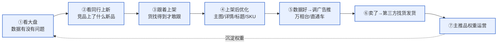
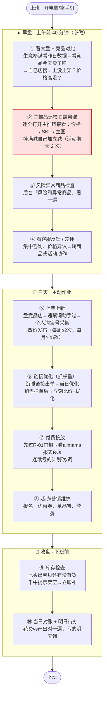

# 运营每日工作流程（执行版）

> **这份文档解决一个问题**：运营每天上班，到底先做什么、再做什么、在哪个后台、怎么做。
> 把散在 [[08-运营组规则]]（规则手册）、[[2026-05-28-天猫运营标准流程SOP]]（理论框架）、[[2026-05-28-祥新实战运营流程-祥书口述]]（实战打法）、[[天猫后台操作手册]]（后台路径）里的东西，收敛成**一条从上班到下班的主线 + 一张流程图 + 后台速查**，照着走就不漏。
>
> 🔴 **为什么重做**：2026-05-26 开会发现，有运营长期漏做「主推品检查」，被问"你每天必做什么"答不上来。**流程不清 → 凭感觉干 → 丢单**。这份就是把"凭感觉"变成"照着做"。

---

## 一、先懂逻辑：运营主线闭环（公司真实打法）

每天那一堆动作不是零散的，它们串成一条闭环。先看懂这条线，每个动作才知道是为啥做：



> **模式底色：轻库存撮合分销**。高尔夫圈的货基本都找得到，所以我们不压货——看同行验证过的新品跟着上，卖出去了再到第三方找货发货。自有库存只押主推/核心品（如倍视能测距仪，自营 96%）。
> 这决定了选品逻辑：**不从 0 研究爆品，看同行验证过的新品直接跟，快、稳、低资金风险。**
> ⚠️ 第⑦步主推品权重运营的内部操作不在本文展开，见本地实战版。

---

## 二、一张图看懂：运营的一天



> **巡店一律用手机看**（不是后台操作时）：顾客都用手机，电脑看不到 88VIP / 专享券等手机端专属优惠，详情图也只有手机端才看得出糊不糊。后台改东西才用电脑。

---

## 三、标准一天时间表（建议时段，按个人节奏调整）

| 时段 | 动作 | 时长 |
|---|---|---|
| 上班 9:00-9:40 | 早盘四件：①看大盘+竞品 ②主推品巡检 ③风险异常 ④客服反馈 | 40 分钟 |
| 上午 9:40-12:00 | ⑤上架上新（选品→采集→发布）+ ⑥链接优化 | 主作业 |
| 下午 14:00-17:00 | 继续上新 / ⑦付费投放调整 / ⑧活动营销维护 / 优化 | 主作业 |
| 活动期 加一次 | 主推品巡检（一天 2 次） | 10 分钟 |
| 下班前 17:30-18:00 | ⑨库存检查 ⑩当日对账+列明日待办 | 20 分钟 |

---

## 四、每天必做（怎么做 + 在哪个后台）

### ① 看大盘 + 竞品对比优化　｜每天，早盘
- **在哪**：生意参谋 · 数据作战室（看大盘）；切「近 30 天」看趋势，单日无意义。
- **怎么做**：看大盘 → 看同行 / 竞品今天卖了什么款 → **立即去自己店搜**：这款上没上架？价格有没有比对方高？
- **动作**：没上 → 立即上链接；高了 → 立即改价 + 优化标题 + 检查 SKU 数有没有比别人少。
- **为什么**：竞品在实时改价，你不跟就丢单（"同一盒货两天前跟两天后价格都不一样"）。
- 配套：飞书 Base「竞品价格监控」「竞品上新监控」每天有自动结果，先看再人工补。

### ② 主推产品巡检　｜每天（活动期每天 2 次）🔴 这次重点补的漏洞
- **怎么做**：逐个打开本店主推 / 有销量的链接，**核心看三项**：
  - **价格**：有没有错价、有没有比同行高
  - **SKU**：规格 / 价格对不对，有没有可以补进链接的关联款
  - **主图**：该上的主图 / 打标有没有上
  - 附带：满减 / 优惠掉没掉（掉了自己加立减）、过期活动有没有还挂着
- **为什么是底线**：自己主卖的几个产品要**如数家珍**，天天看才熟。"有的人连自己主卖哪几个产品都不知道"——这是大问题。一个细节没看到，可能丢很多单。

### ③ 风险 / 异常商品检查　｜每天
- **在哪**：千牛后台「风险和异常商品」。
- **怎么做**：每天看一遍；掉满减的加立减，盯异常数量有没有增加。这是平台帮你筛出的问题清单，不看 = 漏掉系统已报警的事。

### ④ 看客服反馈 / 差评　｜每天，早盘
- **怎么做**：昨天有没有集中咨询的问题、差评、价格异议 → 转成商品动作（改详情 / 补参数）或活动动作。

### ⑨ 库存检查　｜每天下班前（库存深的款可放宽到每周）
- **怎么做**：看已卖出宝贝还有没有库存；千牛 / 手机千牛会提示「库存卖空」→ 立即补。库存加得少的款最容易悄悄卖空，断货还在卖 = 客诉。

---

## 五、上架上新标准流程（每周≥2 次，每月≥25 款）

> 🔴 **6.3 更新**：竞品上新监控**暂停**，全员上架统一**抄「高尔夫自营总店 + 天猫祥新店」**——他上你上，不用自己盘竞品店。多人重复的款先整合到一个文档去重再发群解析。详见文末第十三节。

### A. 选品（定要上哪些款）
1. 维护一张**竞品店清单表**，要盯的竞品店都写进去。
2. 逐个点进去看新款，记录每个店「上次上到哪了」，下次接着往后看，**不重不漏**。
3. 看到新款 → 复制链接 →（先放违禁词助手过一遍）→ 进上架。
4. **巡店用手机**（看得到手机端专属优惠和详情清晰度）。

### B. 采集上架（用采集软件，4 步）
```
①登录淘宝卖家后台（选好目标店铺）
   → ②采集软件里上传竞品链接
   → ③登录【个人淘宝买家号】采集（过验证码）
   → ④软件解析图片/详情 → 改价 → 发布上架
```

### C. 后台原生发品（不用采集软件时，天猫后台）
- **入口**：千牛卖家中心 → 左侧「商品」→ 发布商品。
- **两种发品方式**：
  - **搜索发品**（标品/有型号）：输产品名/型号/条码 → 匹配标准产品库 → 属性自动带出 → 填 SKU+价格即可。👉 测距仪、GPS 手表（Bushnell/Garmin）走这个，输型号秒匹配。
  - **以图发品**（非标品）：传商品图 → AI 自动识别、生成标题、填属性。👉 球包、配件走这个。
- **测距仪类目路径**：户外/登山/野营/旅行用品 → 望远镜/夜视仪/户外眼镜 → **激光测距望远镜**。
- **必填字段**：品牌 + 货号 → 详细表单（标题/卖点/属性/SKU/价格/库存/主图5张+视频/详情页/运费模板/服务承诺/发货时间）。

### D. 🔴 卡点与应对（上架最容易出事的地方）
| 卡点 | 应对 |
|---|---|
| **账号被封** | 采集**只能用个人淘宝号，绝不用千牛/卖家号采集**（卖家号采集极易被封）。每人多备几个个人淘宝号，一个被封换下一个。封号多为临时（3/7/15 天），少有永久。 |
| 号不够用 | 一个手机号约可注册 6 个淘宝号（关联 5 个小号），实名认证上限 3-4 个；可用邮箱注册 + 绑手机 + 解绑扩号。 |
| 鞋服等多规格 SKU 抓不准 | 软件常把图片堆成一排，只能手动去后台改；鞋服上得少，影响不大。 |
| 验证码反复弹 | 采集软件通病，过了才能上。 |
| 担心"数据包/软件上架权重低" | **不必纠结**：实测新品有销量，平台会给新品扶持。 |

> 🔧 **进行中（定了再同步，当前按上述走）**：荔枝跟进采集软件付费插件/换软件解决封号+验证码；祥书测试用 Claude 自动扫竞品店出「新款清单」+ 辅助上架。

---

## 六、链接优化关键动作（好链接是宝贝，别浪费）

| 触发场景 | 立即动作 |
|---|---|
| 新款 / 限量款出来 | **新链接 + 老链接同步上新款**（老链接借权重，新链接开权重，两条腿走） |
| 沉睡链接突然出单 | **当日**优化详情 / 标题 / 价格 / SKU，借权重二次跑起来 |
| 销售拍单后链接起量 | **立刻比价**（高于同行立马调价）+ 优化标题 |
| 卖得好的链接断货 | **别下架**，换同品牌新款 / 当季热款继续上，同步更新主图标题 SKU 价格 |
| 自己想推的款 | 先看同行卖得最好的对标款，照搬最好做法再优化 |
| 店铺形象迭代 | AI 出不了好图就用现成好版式；迭代主图/活动图只**换色系、改活动标题，摆位不动** |

---

## 七、付费推广（要算 ROI 的）

### 前置红线 R-01：无基础不推广
30 天销量 ≥ 3 单 + 真实评价 ≥ 1 条 + 买家秀晒图 ≥ 3 张，**三个同时满足**才能推任何付费（直通车/引力魔方/万相台/淘客）。不达标走自然流量/主图标题优化/老客引导，❌ 不许刷单造假晒图。

### 看报表（每天）
- **入口**：one.alimama.com → 顶部「报表」。
- **账户报表**：按天看 花费 / 总成交 / **ROI** / 点击量 / 点击率 / 展现 / 成交笔数。
- **计划报表**：按计划看好坏，揪出该砍 / 该加预算的。
- **ROI 红线**：净利率 ~3% → **保本 ROI ≈ 30+**。连续亏、低 ROI 的计划果断降价或暂停；在投广告的品断货前必须停车（否则白烧钱）。

---

## 八、活动 / 营销工具（撬客单 + 爆发）

- **入口**：千牛 → 「营销」。子模块：营销工具 / 营销活动 / **活动报名（618 报名在这）** / 消费券 / 淘金币 / 营销托管。
- **能用的促销**：价格计划 / 秒杀（限时折扣）/ 优惠券 / 单品宝（满减·立减）/ 搭配套餐·多件优惠 / 赠品 / 评价有礼 / 客服专属优惠。
- **日常**：挑利润扛得住的品报活动（活动是放大器不是亏本清仓）；掉了满减自己补立减。
- **大促节奏（618/双11）**：蓄水（加购收藏、券蓄客）→ 预售（定金、备库存、客服话术统一）→ 爆发（全力投放、盯库存价格）→ 返场（催尾款、连带、复盘）。

---

## 九、周 / 月固定节奏

### 每周
- **上架 ≥ 2 次**、主推品权重维护按节奏（每周至少 3 天有动作）
- **周一运营周会**：交周报【四段式】摘要 / 数据 / 问题 / 下周计划
- 库存一致性可每周协同仓储核一次

### 每月
- 上月复盘 + 本月目标拆解（拆到周、拆到品、拆到渠道）
- **上架 ≥ 25 款**
- 大促 / 活动日历提前排（618、双 11、品牌日）
- 商品汰换：滞销下架、新品规划（结合库存周报）

---

## 十、🔴 红线（违反必停，先过这一关）

1. **比价以天猫为基准**，不用京东价。
2. **付费推广前置（R-01）**：30 天销量≥3 单 + 评价≥1 + 买家秀≥3 张，三者同时满足才推；❌ 不许刷单造假。
3. **不发"瞒着客户"的虚假单号（R-02）**：定制/缺货/延迟单先跟客户说清征得同意；发占位单号必须同时告知客户，真实单号主动推送。
4. **618 期间不随意改主图**，改前告知祥书。
5. 对外文案禁违禁词；客户隐私（姓名/手机/地址/订单号）不进任何对外内容；后台截图、订单数据不外传。
6. **付费推广必须算 ROI**，低于保本线（≈30+）不许长期挂着烧钱；在投广告的品断货前必须停车。
7. **改价双人核对 + 截图留痕**，价格设置错误率要求 0（错一个价可能巨亏）。

---

## 十一、这次会议补的 5 个漏洞（重点对齐）

> 来源：2026-05-26 荔枝/同同运营流程会。这 5 条是"看着都懂、实际在漏"的地方。

1. 🔴 **主推品检查长期漏做** → 现在是每天必做底线（见 ②），活动期一天 2 次，要如数家珍。
2. 🔴 **运营说不出"每天必做什么"** → 就是这份流程图存在的意义，照着十步走。
3. **上架封号反复发生** → 只用个人淘宝号采集 + 多备号，绝不用卖家号采集。
4. **巡店用电脑看漏掉手机端优惠/详情糊** → 前台巡店一律用手机。
5. **改价口误/错价** → 改价双人核对、截图留痕。

---

## 十二、角色分工速查

| 角色 | 选品上新 | 每日必做 | 侧重 |
|---|---|---|---|
| **荔枝 / 同同** | 自己盘竞品店选品上新 | 早盘四件 + 主推品巡检 + 收盘库存 | 选品上新主力 |
| **娜娜 / 洪洪** | 参考荔枝店 / 高尔夫自营总店跟着上 | 同上（巡自己负责的店） | 跟上 + 巡店 |
| **嘉欣 / 鹤子** | 按分工 | 同上 | 按店分工 |
| **老孙（庆弘）** | 内容 / 短视频 / 直播 | 把内容流量承接到商品页 | 内容流量 |

---

## 十三、6.3 运营对齐会更新（2026-06-03）

> 来源：6.3 两场运营对齐会（团队流程培训 + 嘉欣 1v1 复盘）。已同步到运营可视化页 `app_4k9veug1h43sn`。

1. **竞品上新监控暂停**：四人监控控不明白 → 上架统一抄「高尔夫自营总店 + 天猫祥新店」，他上你上。
2. **多人去重**：重复的款先整合到一个文档再发群解析，避免重复上架。
3. **巡店频次固化**：主推品不少于两天看一次（最好每天）；活动期后台一天看两次。
4. **促销必检查**：凡动促销 / 设活动，记死生效时间点并复查一遍（嘉欣 S70 错价 = 设了没检查）。
5. **图片水印**：识图找无水印同行 / 小红书旗舰店 / 千牛主图 AI 去水印。
6. **无货款别直接下架**：京东按 SKU 权重，下架掉权重 → 替换同系列 / 同色 / 同品牌当季款。
7. **官方套餐必跟**：别人天猫上了官方套餐就跟上，别只挂裸款。
8. **刷单 / 补单后必须推广告 + 优化**（照天猫卖得好的对标款抄），否则白补。

---

> **维护**：本流程随实践迭代。与 [[08-运营组规则]] 的关系——那份是**规则全集**（红线 + 关键动作 + 框架），本份是**每日执行主线 + 流程图 + 后台速查**，两者一套。重大变更同步飞书 wiki「运营工作流程框架」。
